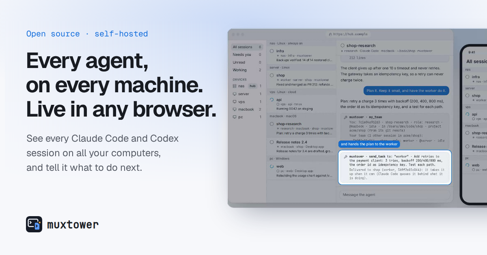

<p align="center">
  
</p>

<h1 align="center">muxtower</h1>

<p align="center"><b>See and direct the coding agents on all your machines, from any browser or your phone.</b></p>

<p align="center">
  <a href="https://pypi.org/project/muxtower/"></a>
  <a href="https://pypi.org/project/muxtower/"></a>
  <a href="https://github.com/jiaton/muxtower/blob/main/LICENSE"></a>
  <a href="https://github.com/jiaton/muxtower/actions/workflows/ci.yml"></a>
  <a href="https://github.com/jiaton/muxtower/tags"></a>
</p>

<p align="center">
  <a href="https://muxtower.dev">muxtower.dev</a> · <a href="https://muxtower.dev/demo/">Live demo</a> · <a href="https://app.muxtower.dev">Hosted app</a>
</p>

<p align="center">
  
</p>

muxtower is a small daemon that runs next to your agents (Claude Code, Codex, …). It shows what every session on every computer is doing, live, in a web app that works in any browser and installs on your phone, and lets you talk to any of them from there.

- **Every agent's state, live.** Working, waiting on you, or done. Claude Code and Codex report through their own hooks; other terminal agents are read with rules you can edit.
- **Direct any of them from anywhere.** Read the conversation, reply to a line, type or speak (Live), and get a push when one is done or needs you.
- **Teams of agents.** Each session has a role and a project; agents find each other with `my_team` and hand each other work with `send_task`, on one machine or across several.
- **All your computers in one list.** Join them to one hub; a laptop needs no address of its own, and while the hub restarts the app reaches the others directly.
- **Yours to host.** One `pipx install`, and the daemon serves the app itself. No account, no cloud service; every device has its own revocable token.

> Status: early (0.1.x). Interfaces may change.

## Quick start

Needs Python 3.11+, tmux, pipx, and Claude Code or Codex.

```sh
pipx install muxtower          # then `pipx ensurepath` and a new shell, if `muxtower` is not found
cd ~/code/my-project
muxtower run claude            # starts the daemon, opens Claude Code in a managed tmux session
muxtower expose tailscale      # an HTTPS address on your tailnet (or put any proxy in front)
muxtower pair                  # a one-time code for your phone (and a QR code, once it has an https address)
```

To try it without a phone, open http://127.0.0.1:8731 on this machine; HTTPS is only needed for the phone. More: [install, HTTPS and running it as a service](https://github.com/jiaton/muxtower/blob/main/docs/install.md).

## What it does

| Feature | |
|---|---|
| Approve and answer | prompts and questions with their options, from the phone; push notifications when a session needs you |
| Live terminal and conversation | each session's screen and its conversation, with an input bar, voice and pictures |
| Sessions you already run | agents started in plain tmux are found by themselves; Claude's Remote Control and Codex's app-server sessions are listed too |
| [More than one computer](https://github.com/jiaton/muxtower/blob/main/docs/multi-machine.md) | one hub lists every computer's sessions; a node needs no address; direct fallback while the hub is down |
| [Teams](https://github.com/jiaton/muxtower/blob/main/docs/teams.md) | roles, projects, `send_task`, watching another session, warnings when two write in one worktree; MCP tools and a concierge |
| [Agents and permission modes](https://github.com/jiaton/muxtower/blob/main/docs/agents.md) | Claude Code, Codex, screen rules as TOML, a permission mode per session |
| [The web app](https://github.com/jiaton/muxtower/blob/main/docs/web-app.md) | served by the daemon, or hosted by you, or [app.muxtower.dev](https://app.muxtower.dev); and a [glasses app](https://github.com/jiaton/muxtower/blob/main/docs/g2.md) |
| After a restart | interrupted sessions are kept and started again in their conversation, when you say so |
| [Configuration](https://github.com/jiaton/muxtower/blob/main/docs/configuration.md) | a TOML file, environment variables, and a settings page in the app |

## Engineering

- **State from hooks, checked against the screen.** Hooks say exactly what an agent wants; screen rules cover what hooks miss, and the app shows which rule matched.
- **Nothing typed blindly.** Approving re-reads the live screen first and moves to the chosen option with the arrow keys.
- **Screens as patches.** The app gets each next screen as the lines it shares with the one before plus the new ones: on a busy session about 80 times less data than whole screens.
- **One token per device, one-time pairing codes.** Codes expire in five minutes and travel in the URL fragment; only a wrong credential answers 401, so fail2ban can count guesses. [Security model](https://github.com/jiaton/muxtower/blob/main/docs/security.md).
- **One package.** The daemon is a single pipx install with the app inside; a typed HTTP and WebSocket API ([design](https://github.com/jiaton/muxtower/blob/main/docs/design.md)).

## Why not just…

- **Claude Code's Remote Control, or the Codex app?** Each reaches only its own agent, one session at a time. muxtower puts every Claude Code and Codex session on all your computers in one list, shows which one is waiting on you and for what, and lets the agents hand each other work.
- **SSH and tmux from your phone?** It works, but you find who is waiting yourself, window by window, and approving on a phone keyboard is clumsy.
  muxtower needs no SSH key on the phone and no SSH port open to the internet: the phone holds a device token you can revoke at any time, which reaches the agents' sessions (reading them, approving, typing to them) and not a shell on the machine.

## Development

`daemon/` is the Python package, `app/` the web app, `glasses/` the glasses app, `site/` muxtower.dev. `make check` runs what CI runs; see [AGENTS.md](https://github.com/jiaton/muxtower/blob/main/AGENTS.md) and [docs/design.md](https://github.com/jiaton/muxtower/blob/main/docs/design.md).

## License

[Apache-2.0](https://github.com/jiaton/muxtower/blob/main/LICENSE)
